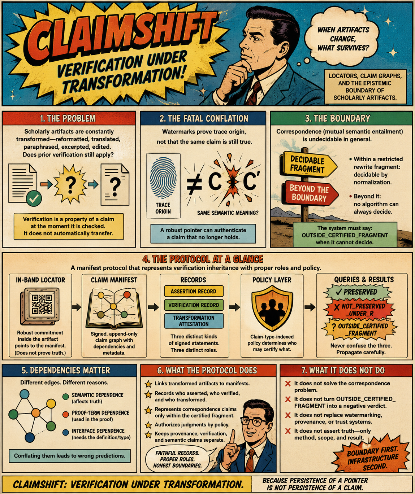

# Claimshift

**A formal verification inheritance framework for scholarly artifacts under transformation**

Claimshift is a research artifact implementing and demonstrating a manifest protocol for verification inheritance—addressing the fundamental question: *when a verified claim is transformed, can the original verification be inherited by the successor?*

## Overview

This repository contains the formal artifacts, mutation testing framework, and research papers supporting a three-paper series on verification inheritance:

- **Paper I**: *Verification Inheritance Under Transformation* — Theory and undecidability results
- **Paper II**: *A Manifest Protocol for Verification Inheritance* — Locators, claim graphs, and policy-qualified trust
- **Paper III**: *Mutation Testing for Verification Inheritance* (this repository's primary experimental artifact)

The project demonstrates that:
1. Verification inheritance is undecidable in general but decidable within bounded rewrite fragments
2. A manifest protocol can represent verification across transformations without conflating assertion, verification, and transformation attestation
3. Mutation testing can validate dependency propagation in verification systems



## Key Components

### 📐 Formal Verification Artifact

**`AdmissibilityTransitionSystem.lean`** — A frozen mathematical specimen designed for mutation testing:

- **No dependencies**: Pure Lean 4 core (no Mathlib)
- **Asymmetric dependency graph**: Two branches sharing a common dependency (D2)
- **Verified theorems**: Global admissibility (T1) and fiber non-interference (T2)
- **Zero axioms** beyond Lean's core (`propext`, `Quot.sound`)
- **Kernel-verified**: Clean exit with zero `sorry` statements

The system models a simplified state transition system with:
- Three locations (fibers): `l0`, `l1`, `l2`
- Four primitives: `Pop`, `Refuse`, `Bind`, `Collapse`
- Bound-count parity invariant
- Non-vacuity witnesses

### 🧬 Mutation Testing Framework

**`paper3-audit/`** — Preregistered mutation matrix with 20 mutants:

| Mutation Class | Examples | Purpose |
|----------------|----------|---------|
| **α-renaming** | M01, M02 | Certified rewrite fragment baseline |
| **Commutative reordering** | M03, M04 | AC-normalization |
| **Constant mutation** | M09, M10 | **Flagship**: Isolate branch dependencies |
| **Quantifier mutation** | M13, M14 | Test weakening vs. falsification |
| **Hypothesis deletion** | M15 | **Flagship**: Self-refutation via existing witness |
| **Definition mutation** | M20 | **Flagship**: Mid-branch propagation patterns |

Each mutant is preregistered with ground-truth predictions (`G_m`) before measurement, following the principle: **"ground truth first, then observation—never the reverse."**

### 📄 Research Papers

- `manifest-protocol-verification-inheritance.pdf/.tex` — Paper II
- `verification-inheritance-transformation.pdf/.tex` — Paper I
- Associated LaTeX sources with formal definitions and theorems

## Design Principles

The protocol enforces strict separation of concerns:

1. **The locator is not the evidence** — Robust pointers establish artifact identity, not correctness
2. **Authorship ≠ generation** — LLM outputs require human assertion signatures
3. **Assertion ≠ verification** — Claiming a theorem is distinct from proving it
4. **Verification ≠ truth** — All verification is method-relative
5. **Certification failure ≠ failure certification** — Three-valued logic: `PRESERVED`, `NOT_PRESERVED`, `OUTSIDE_FRAGMENT`

## Technical Stack

- **Proof Assistant**: Lean 4.10.0
- **Verification**: Kernel-checked proofs (no `sorry`, no Classical.choice beyond core)
- **Mutation Testing**: Preregistered protocol with JSON-serialized dependency audits
- **Documentation**: LaTeX (research papers), Markdown (mutation matrix)

## Quick Start

### Prerequisites

```bash
# Lean 4.10.0 (fetch from leanprover/lean4 v4.10.0 release)
# No lakefile, no Mathlib—plain Lean core only
```

### Verify the Baseline Artifact

```bash
# Kernel-check the frozen specimen
lean AdmissibilityTransitionSystem.lean
# Expected: exit code 0, zero errors, zero sorry
```

### Run Dependency Audit

```bash
# Generate typed dependency graph
lean DependencyAuditTyped.lean
# Outputs: baseline_typed_edges.json
```

### Inspect Mutation Matrix

```bash
cd paper3-audit
cat mutation-matrix.md
# 20 preregistered mutants with ground-truth predictions
```

## Repository Structure

```
claimshift/
├── AdmissibilityTransitionSystem.lean          # Frozen baseline specimen
├── AdmissibilityTransitionSystem_VERIFICATION.txt  # Verification log
├── DependencyAudit.lean                        # Dependency graph extractor
├── DependencyAuditTyped.lean                   # Typed edge classifier
├── manifest-protocol-verification-inheritance.pdf  # Paper II
├── verification-inheritance-transformation.pdf     # Paper I
├── paper3-audit/
│   ├── mutation-matrix.md                      # Preregistered 20-mutant matrix
│   ├── baseline_G_Lean.json                    # Baseline dependency graph
│   ├── baseline_typed_edges.json               # Typed edges (D1/D2/D3/L1/L2/L3)
│   ├── batch1/                                 # Mutant batch 1 (M01-M10)
│   ├── batch2/                                 # Mutant batch 2 (M11-M20)
│   └── rm_and_safety/                          # Mutation safety protocols
└── README.md                                    # This file
```

## Mutation Testing Protocol

### Ground Truth First

Every mutant is **preregistered** before execution:

1. **G_m** (ground truth): Predicted logical relationship to original
   - `equivalent` — Certified rewrite fragment (T_R)
   - `stronger`, `weaker`, `incompatible`, `unrelated`
   - `refuted` — False independent of original
2. **Predicted failure sets**: Which theorems should fail
3. **Predicted propagation**: Which branches affected (D1-only, D2-shared, mid-branch)

### Measurement Phase

After preregistration, the harness measures:

- **O_m**: Observed logical relationship
- **F_m**: Failure set (which theorems fail to kernel-check)
- **R_m**: Reprovability (can failed theorems be proved via different proofs?)

### Flagship Mutants

- **M09** (constant mutation in D1): Isolates branch-root propagation (predicts L1/L2/T1 fail, L3/T2 untouched)
- **M15** (hypothesis deletion): Self-refuting via existing kernel-checked witness
- **M20** (definition mutation): Mid-branch propagation (hits L2/T1, not L1, not T2)
- **M10** (parity flip): "Reprovability is not verification inheritance" — still provable despite logical difference

## Key Insights

### From the Formal Artifact

- **Dependency isolation**: Two-branch asymmetric graph with shared node (D2) enables targeted mutation testing
- **Non-vacuity**: `local_step_changes_own_fiber` provides constructive witness that L3 has genuine content
- **Minimal axioms**: Only `propext` and `Quot.sound` (no Classical.choice)

### From Mutation Testing

- **Weakening ≠ easier**: M13 shows weakening a hypothesis can make downstream proofs *harder*
- **Trivial hypotheses ≠ safe**: M17 shows even tautologically true hypotheses can lead to false theorems
- **Semantic coarseness**: M12 shows boundCount-parity is too coarse to detect certain semantic changes

### From the Protocol

- **Three-valued certification**: Never conflate "cannot certify" with "certifies negative"
- **Role separation**: Assert, verify, and transform-attest are cryptographically distinct
- **Policy qualification**: Only authorized adjudicators can issue transformation judgments

## Contributing

This repository contains frozen research artifacts for Paper III. The mutation testing protocol requires:

1. **Preregistration discipline**: Ground truth before observation
2. **Kernel verification**: Every claim must exit with code 0, zero `sorry`
3. **Dependency tracking**: All edges must appear in typed audit JSON
4. **Mutation safety**: Never commit uncommented mutants to baseline branch

See `paper3-audit/rm_and_safety/` for mutation protocol details.

## Citation

If you use this work, please cite:

```bibtex
@misc{claimshift2026,
  author = {Flyxion},
  title = {Claimshift: A Manifest Protocol for Verification Inheritance},
  year = {2026},
  howpublished = {\url{https://github.com/8b-is/claimshift}},
  note = {Research artifact for mutation testing of verification inheritance systems}
}
```

## License

See [LICENSE](LICENSE) for details.

## Project Status

**Current**: Paper III experimental phase—mutation matrix preregistered, harness implementation in progress.

**Next**: Execute 20 mutants, measure O_m/F_m/R_m, validate predictions against ground truth.

## Acknowledgments

This work builds on:
- The Lean 4 proof assistant and kernel verification
- Research on transformation semantics and scholarly provenance
- Mutation testing methodologies for formal systems

---

**Frozen specimen tag**: `baseline-v1.0-paper3`  
**Toolchain**: Lean 4.10.0 (x86_64-unknown-linux-gnu, commit c375e19f6b65)  
**Verification log**: See `AdmissibilityTransitionSystem_VERIFICATION.txt`
